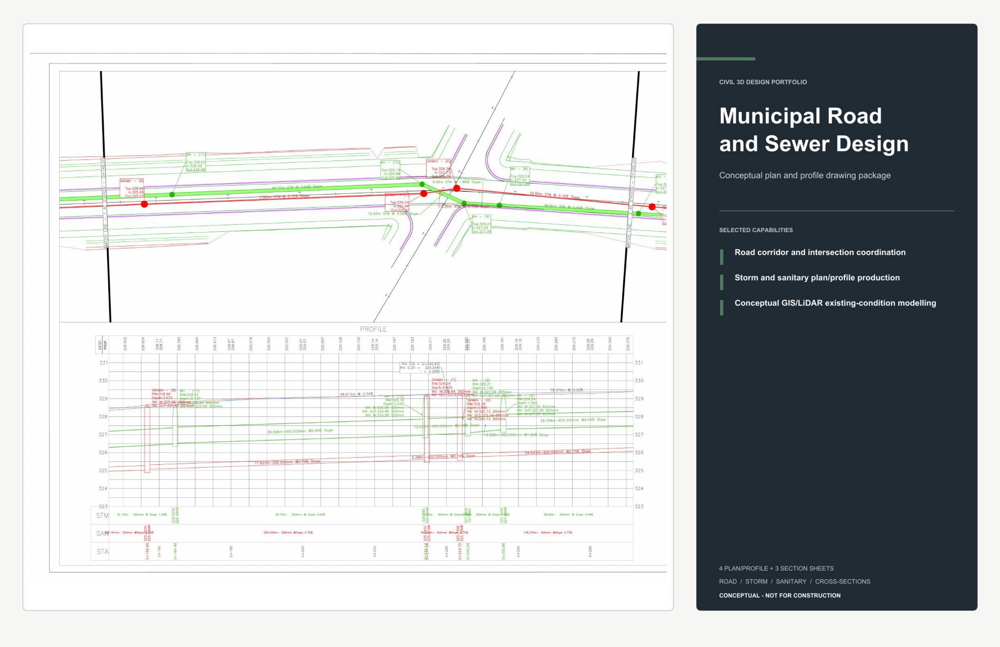
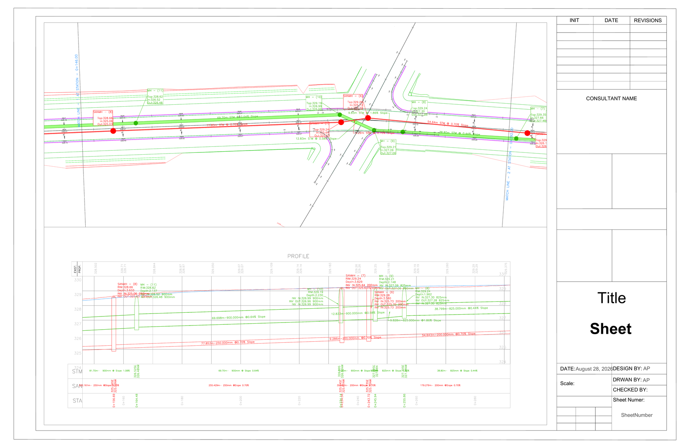

# Municipal Road and Sewer Design Portfolio


An anonymized Civil 3D portfolio demonstrating a coordinated municipal road and sewer model carried from public terrain information through plan/profile sheet production.

> **Conceptual Portfolio Project - Not for Construction.** This repository demonstrates software and drawing-production skills. It is not an issued design, permit submission, tender package, record drawing or construction document.

[](docs/Municipal_Road_and_Sewer_Design_Portfolio.pdf)

<div align="center">

**Click the cover to open the complete portfolio.**

</div>

## Portfolio

[View the complete portfolio PDF](docs/Municipal_Road_and_Sewer_Design_Portfolio.pdf)

[View the municipal road cross-section drawing package](docs/Municipal_Road_Cross_Sections.pdf)

The portfolio presents the project brief, design-basis and verification matrix, controlled model-to-sheet workflow, municipal authorization workflow, four plan/profile drawing exhibits, a three-sheet road cross-section package, and an explicit senior-review boundary.

## Project at a Glance

| Design component | Demonstrated work |
|---|---|
| Existing conditions | Existing-ground surface assembled from publicly available mapping and LiDAR-derived terrain information |
| Road | Alignment, profile, corridor modelling, intersection lane-width coordination and cross-section sheet production |
| Storm sewer | Pipes, maintenance structures, plan/profile display, labels and profile bands |
| Sanitary sewer | Pipes, maintenance structures, plan/profile display, labels and profile bands |
| Drawing production | View frames, match lines, plan/profile and cross-section sheets, colour plotting and sheet-set publication |
| Quality review | Network/profile consistency, structure placement, slopes, inverts, cover targets and drawing readability |

## Drawing Sample



## Road Cross-Section Views

[Open the three-sheet cross-section drawing package](docs/Municipal_Road_Cross_Sections.pdf)

The cross-section package demonstrates how the corridor model was sampled and presented for grading review. It contains 29 section views at 20 m intervals from station 0+020 to 0+580. Each view uses an offset range of approximately 20 m left and right of the road centreline and an elevation grid suited to the local ground and corridor elevation.

### Information Presented

| Section-view element | Purpose in the drawing review |
|---|---|
| Station label | Identifies the location of each sampled corridor section along the road alignment |
| Offset grid | Provides horizontal reference from the alignment centreline to the left and right sides of the corridor |
| Elevation grid | Supports comparison of existing and proposed levels across each section |
| Existing-ground line | Shows the interpreted terrain derived from the conceptual existing-ground surface |
| Proposed corridor links | Show the modelled crown, lane, gutter/curb and roadside grading geometry where represented by the corridor assembly |
| Centreline elevation | Reports the sampled road-centreline level for coordination with the finished-grade profile |
| Crossfall labels | Communicate the modelled lane or surface slopes, typically 2.0% away from the crown in regular road sections |
| Local transition sections | Reveal changes in width, slope and corridor geometry near intersection and tie-in regions |

### Civil 3D Production Method

1. Create sample lines perpendicular to the road alignment at the required station interval and at critical geometry locations.
2. Add the existing-ground surface and finished corridor surfaces or corridor links as sampled section sources.
3. Generate multiple section views using a consistent section-view style, grid, offset range and elevation-datum strategy.
4. Apply section labels for station, centreline elevation, offsets, elevations and crossfall values.
5. Arrange the views into section sheets and review the sequence for consistent scales, spacing and station progression.
6. Rebuild the corridor and update the section views whenever profiles, assemblies, targets or corridor regions change.

### Design Review Use

The section views support review of crown-to-gutter drainage, typical lane crossfall, corridor width transitions, intersection tie-ins, daylight behaviour and differences between existing and proposed grades. They also provide a visual QA check that the corridor assembly and targets are behaving consistently between plan and profile control points.

These sheets demonstrate Civil 3D section-view production; they do not establish final earthwork quantities, property impacts, accessibility compliance, utility clearances or construction-ready grading. The generic title-block fields remain placeholders and must be completed before any formal drawing issue.

## Model and Production Workflow

1. Organize GIS and LiDAR-derived source information and state its limitations.
2. Develop the existing-ground surface, alignments and reference profiles.
3. Model the road corridor, intersection geometry, lane transitions and grading intent.
4. Coordinate storm and sanitary pipes and structures in plan and profile.
5. Assemble production drawings using data shortcuts, XREFs, profile bands, view frames and match lines.
6. Generate and review corridor cross-sections at regular and critical stations.
7. Publish the colour sheet set and complete model, annotation and PDF checks.

## Conceptual Design Basis

The model was developed using the following project controls, interpreted from applicable local municipal infrastructure requirements:

| Design element | Criterion applied in the conceptual model |
|---|---|
| Storm sewer cover | Minimum target of 1.5 m; current exported results include exceptions that require correction and re-verification |
| Sanitary sewer cover | Minimum target of 2.5 m; independent network-export verification remains pending |
| Road profile | Grades and vertical transitions checked against applicable municipal geometric requirements |
| Lane drainage | Typical 2.0% crossfall from crown toward gutter where applicable |
| Horizontal coordination | Lane widths, intersection tie-ins and corridor-region transitions coordinated by station |
| Pipe-network coordination | Diameters, slopes, inverts, structure depths, cover and crossings reviewed in plan and profile |
| Drawing coordination | Plan/profile agreement, labels, bands, match lines and colour plotting reviewed |

These are portfolio design controls, not claims of completed compliance. The storm network must be rebuilt and its cover exceptions resolved; the sanitary network still requires an equivalent independent cover report. A real project also requires current survey, utility records, geotechnical information, hydrology and hydraulic calculations, downstream-capacity confirmation, constructability review and licensed engineering oversight.

## Municipal Delivery and CLI-ECA Workflow

1. **Confirm project scope and asset ownership.** Identify existing and proposed works, who owns and operates them, whether proposed works will be transferred to the municipal owner, and whether the activity is maintenance, repair, a lateral connection or an alteration.
2. **Obtain the owner's current environmental approval and requirements.** Confirm whether the work affects a municipal sewage collection system, stormwater management system or privately owned works. Establish prescribed-person status and request pre-consultation where needed.
3. **Determine the authorization route.** Schedule D contains the conditions for future pre-authorized alterations. If the proposed alteration satisfies every applicable condition, complete the pre-authorized process and required records. If it is not pre-authorized, the approval holder or an authorized party must obtain a Schedule C amendment before undertaking the alteration.
4. **Prepare the design-stage submission.** Assemble the design brief, stamped drawings when required, design sheets, calculations, supporting reports, criteria-exception list, inspection/testing plan and applicable alteration records. Typical records include SS1/SS2 for sewage collection works and SW1/SW2/SW3 for stormwater works, depending on scope.
5. **Complete detailed design and QA/QC.** Coordinate road geometry, survey, existing utilities, geotechnical constraints, hydrology/hydraulics, receiving-system capacity, pipe cover and clearances, constructability, quantities, specifications and independent checking.
6. **Screen parallel approvals.** Confirm applicable planning and Environmental Assessment Act obligations, conservation authority and source-protection requirements, road and utility permits, heritage/archaeology, property/easements, traffic staging, erosion and sediment control, and stakeholder consultation.
7. **Construction and closeout.** Maintain inspection and testing records; complete CCTV, mandrel, leakage or other testing as applicable; resolve deficiencies; prepare as-built information and O&M documentation; complete post-construction verification; and submit required owner or Director notifications.

The CLI-ECA pathway does not itself prove that downstream capacity exists, that all other permits are satisfied, or that the work is ready for construction.

### Regulatory Source Basis

The delivery workflow is based on current Ontario Ministry of the Environment, Conservation and Parks material:

- [Municipal Consolidated Linear Infrastructure Environmental Compliance Approvals](https://www.ontario.ca/page/municipal-consolidated-linear-infrastructure-environmental-compliance-approvals)
- [Supporting documentation and technical requirements for an ECA](https://www.ontario.ca/document/guide-applying-environmental-compliance-approval-0/supporting-documentation-and-technical)
- [Ontario Central Forms Repository - MECP CLI-ECA records](https://forms.mgcs.gov.on.ca/en/dataset/?_organization_limit=0&organization=ministry-of-environment-conservation-and-parks&q=CLA-1-F)

The municipality's current CLI-ECA, project-specific conditions and latest forms must always be checked before using this workflow on a real project.

## Verification Status

| Status | Scope |
|---|---|
| Demonstrated | Civil 3D object organization, road and intersection coordination, pipe-network plan/profile display, annotation, bands, XREFs, view frames, match lines and colour sheet publication |
| Requires further checking | Pipe connectivity, all cover values, crossings, hydraulic capacity, downstream reserve capacity, design exceptions and drawing-sheet defect review |
| Not represented as complete | Survey verification, utility locates, geotechnical design, quantities, specifications, approvals, licensed engineering review, construction inspection and as-built closeout |

## Data and Engineering Limitations

Existing conditions were interpreted from public GIS and LiDAR-derived terrain information. Utility locations, elevations, materials and capacities require survey, records review, subsurface investigation, field verification and engineering review before real-world use.

The drawings have not been independently checked, approved, sealed, tendered or constructed. File existence and successful Civil 3D regeneration do not establish technical compliance or design suitability.

## Repository Structure

```text
.
|-- README.md
|-- PROJECT_NOTES.md
|-- docs/
|   |-- Municipal_Road_and_Sewer_Design_Portfolio.pdf
|   `-- Municipal_Road_Cross_Sections.pdf
`-- assets/
    |-- portfolio-cover.png
    `-- plan-profile-sample.png
```

## Software

- Autodesk Civil 3D
- AutoCAD sheet sets and external references

## Author Note

This project is intentionally anonymized. The public repository excludes original survey data, GIS source files, proprietary references, editable production drawings and any real street name.
